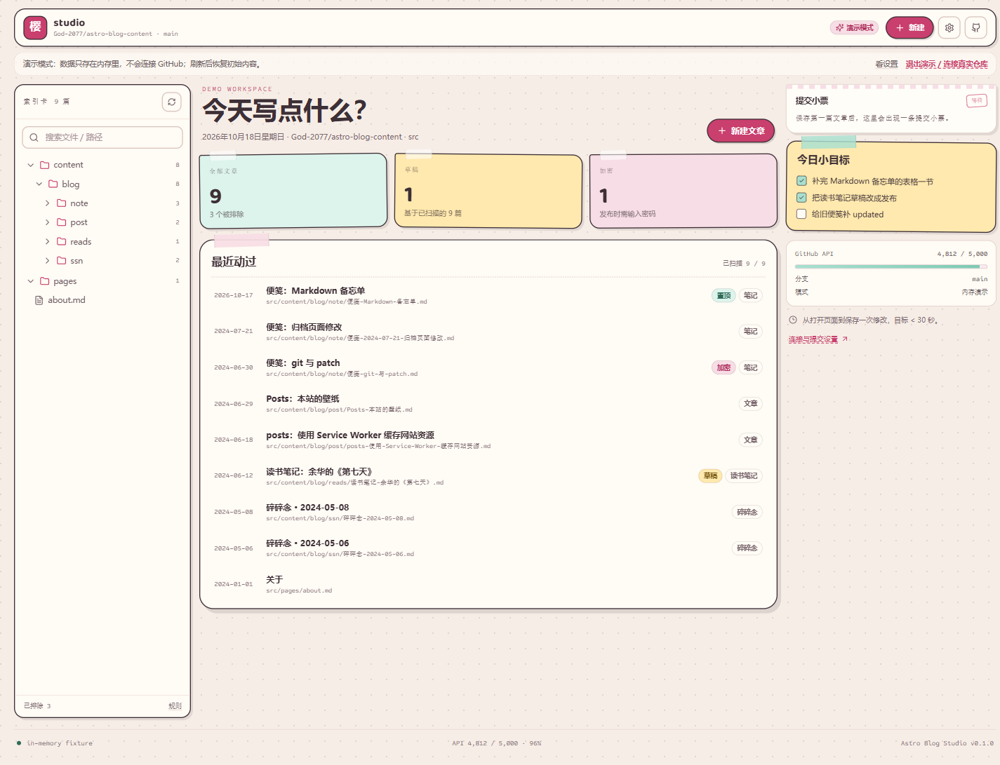
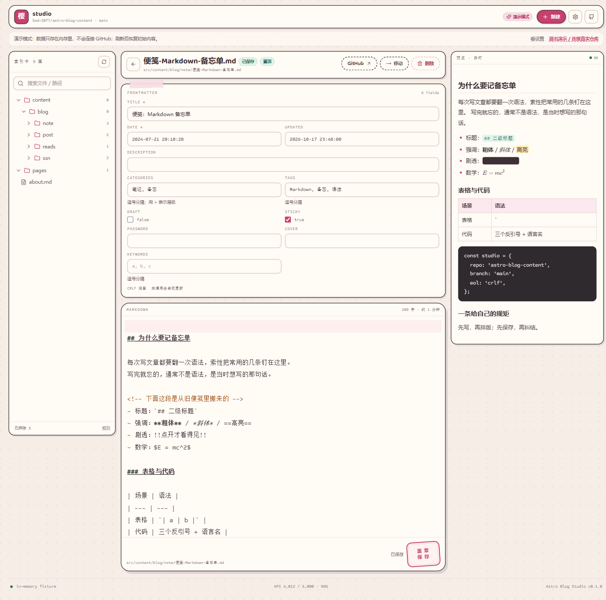
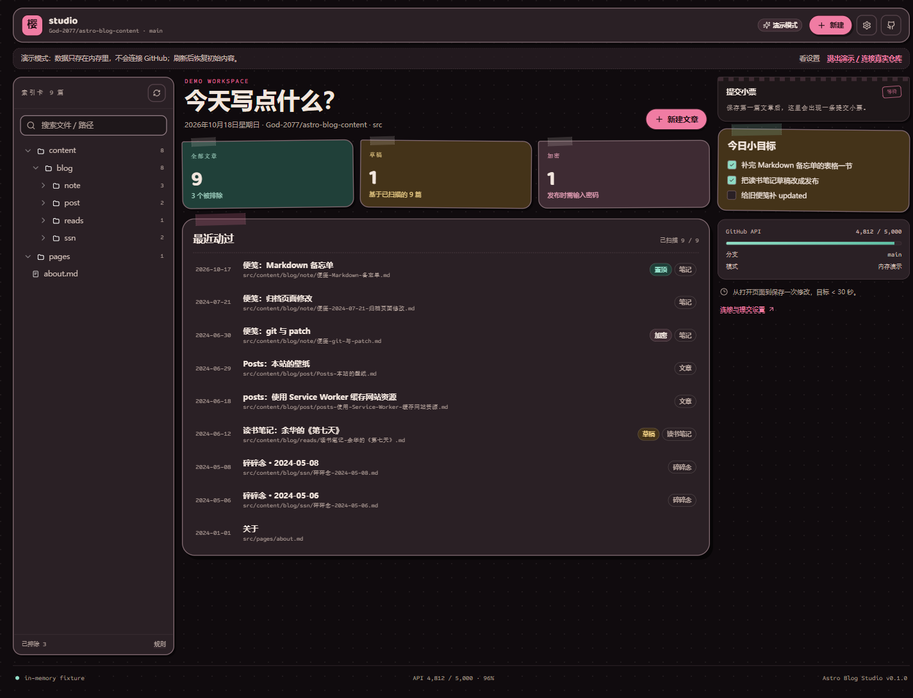
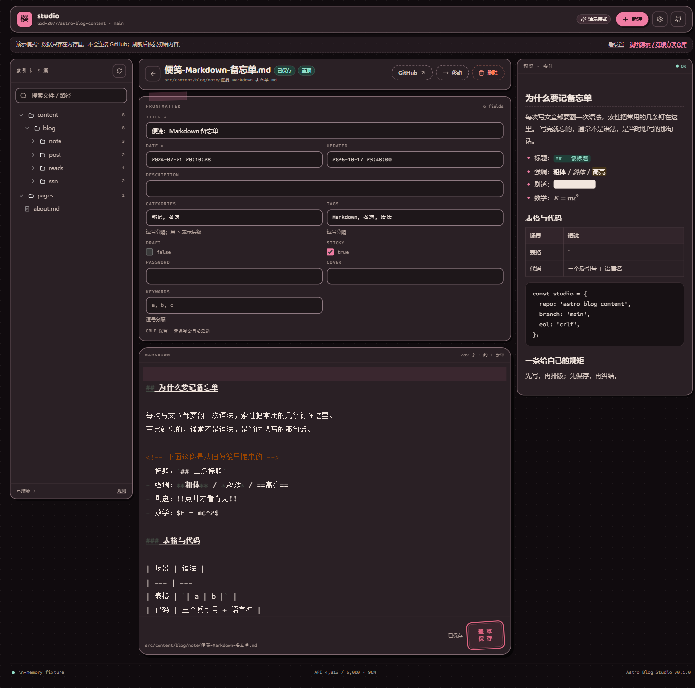

# Astro Blog Studio

浏览器端、纯前端的 Markdown 博客工作台：用 GitHub API 直接读写内容仓库里的 Markdown，不需要后端服务器，也不把令牌交给任何第三方。

源码：<https://github.com/God-2077/astro-blog-studio>






## 快速开始

```bash
cd astro-blog-studio
pnpm install
pnpm dev
```

打开 <http://localhost:5173>；先看界面：<http://localhost:5173/?demo=1>。

- 单元测试：`pnpm test`
- 类型检查 / 静态检查 / 构建：`pnpm typecheck`、`pnpm lint`、`pnpm build`
- 完整测试命令、覆盖清单与测试仓库：[docs/testing.md](docs/testing.md)

> 自动测试使用 `astro-blog-content-test` 专用测试仓库；真实的 `astro-blog-content` 请单独创建一个只授权它的 fine-grained token；测试 token 不要用于生产。

## 使用与安全

完整内容见 [docs/guide.md](docs/guide.md)：
- **首次连接**：创建 fine-grained PAT、填写仓库/分支/根目录、选择解锁方式（设备指纹 / 密码 / 密码 + 设备双因子）。
- **功能**：文件索引、CodeMirror 编辑 + 预览（代码块语法高亮，未写语言时自动识别）、frontmatter 表单、写操作与冲突处理、格式保真、提交模板、本机加密草稿箱（显式草稿 + 自动备份，多篇并存）、本机加密文章缓存 + 增量同步、真实/演示双模式、夜间外观、保险库、设置、响应式、PWA。
- **安全模型**：PAT 只在浏览器内 AES-GCM 加密存储、密码才是安全边界、会话与锁定机制、真实仓库的未保存备份、草稿箱与文章缓存均为密文、渲染与运行时约束。

## 已知限制

完整内容见 [docs/guide.md#已知限制](docs/guide.md#已知限制)：单文件编辑（无图片上传、无跨文件搜索、无版本历史、无 PR 流程）；冲突无逐行 merge；只支持 UTF-8 Markdown/MDX；GitHub Contents API 单文件约 1 MB 限制；设备指纹非安全边界；未保存备份、草稿箱与文章缓存仅限本机、跨设备不同步；离线只缓存前端壳，无离线保存队列；Service Worker 更新不强制刷新。

## 构建与部署

```bash
pnpm build     # dist/
pnpm preview   # http://localhost:4174
```

部署到任意静态托管即可（GitHub Pages / Cloudflare Pages / Netlify / Nginx）。使用 HashRouter，不需要 SPA 重写规则。如果部署在子路径，构建时设置 `STUDIO_BASE=/studio/`（Vite `base`）：

```bash
STUDIO_BASE=/studio/ pnpm build
```

> 项目已验证到 `dist` 构建与 `vite preview` 产物；生产域名的 DNS/TLS/CSP 由部署平台负责。构建会额外产出 `dist/sw.js`、`dist/manifest.webmanifest` 与 `dist/icon-*.png`（PWA），部署时把它们和 `dist/index.html` 一起发布即可；缓存与 CSP 头的要求见 [PWA 与离线](docs/architecture.md#pwa-与离线)。

## License 与文档索引

GNU Affero General Public License v3.0（`AGPL-3.0-only`），见 [LICENSE](LICENSE)。与同仓库的 `astro-blog` 保持一致。

© 2026 God-2077

文档索引：

- [使用指南](docs/guide.md)：首次连接、功能清单、安全模型、已知限制。
- [未保存备份](docs/backup.md)：加密、恢复弹窗、409、新稿、清除时机、设置开关。
- [草稿箱](docs/drafts.md)：多篇显式草稿、加密、从草稿箱打开、提交后清理、与自动备份的区别。
- [本机文章缓存与增量同步](docs/content-cache.md)：GraphQL 批量、diff 规则、AAD、并发、降级。
- [测试](docs/testing.md)：测试覆盖清单、手动 E2E、测试仓库与 Playwright 说明。
- [架构](docs/architecture.md)：目录结构、内容与提交规则、设置项、PWA 与离线/更新提醒。
- [DESIGN.md](DESIGN.md)：视觉/交互实现规范。
- [PRODUCT.md](PRODUCT.md)：产品事实与目标。
- [AGENTS.md](AGENTS.md)：本子项目的 agent 约束。
- [plan.md](plan.md)：原始需求。
- [design/directions.html](design/directions.html)：4 个方向 × 5 个视图 + 对比板。
- [design/DECISION.md](design/DECISION.md)：01 樱糖手帐，六段契约。
- [docs/screenshots/](docs/screenshots/)：成品截图（生产构建 + `?demo=1` 固定数据，2026-10-18）。

视觉方向来自本仓库的决策台 **01 樱糖手帐**：文件是索引卡，编辑是纸，提交是盖章。决策过程与完整原型见 [design/directions.html](design/directions.html) 和 [design/DECISION.md](design/DECISION.md)。
