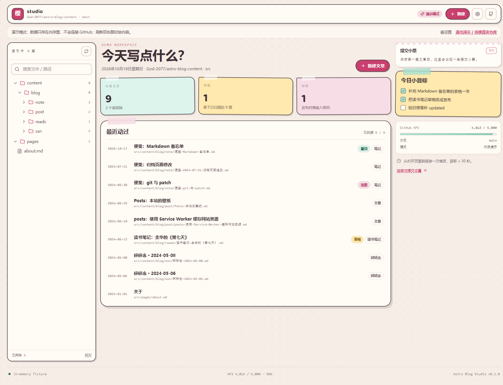
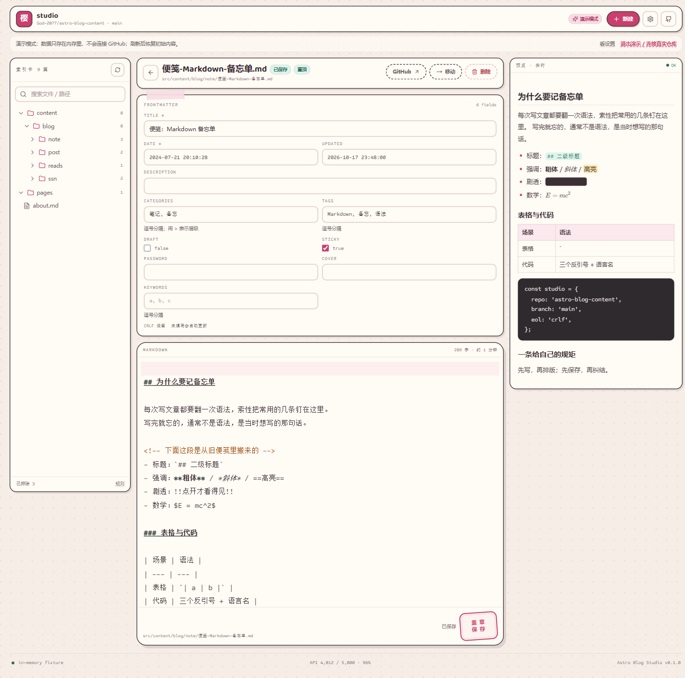
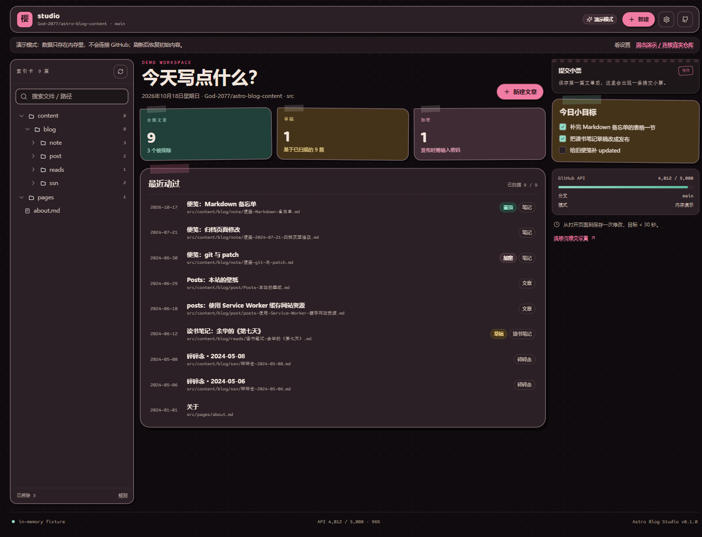
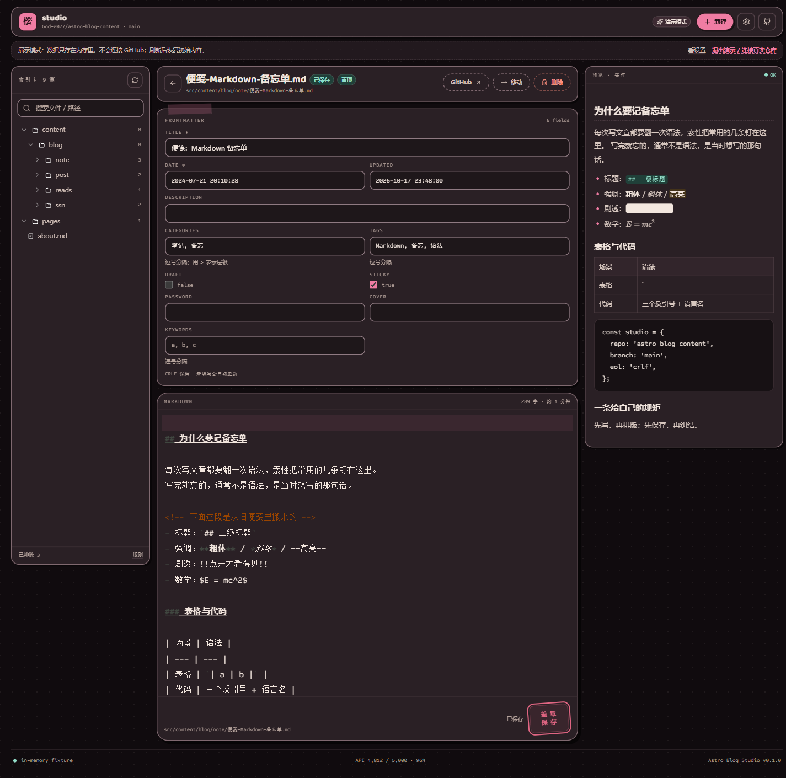

# Astro Blog Studio

浏览器端、纯前端的 Markdown 博客工作台：用 GitHub API 直接读写内容仓库里的 Markdown，不需要后端服务器，也不把令牌交给任何第三方。

源码：<https://github.com/God-2077/astro-blog-studio>

网站：<https://sakura.ksable.top/>






## 快速开始

```bash
cd astro-blog-studio
pnpm install
pnpm dev
```

打开 <http://localhost:5173>；先看界面：<http://localhost:5173/?demo=1>。

- 单元测试：`pnpm test`
- 类型检查 / 静态检查 / 构建：`pnpm typecheck`、`pnpm lint`、`pnpm build`
- 完整测试命令、覆盖清单与测试仓库：[docs/testing.md](docs/testing.md)
- 版本号：`package.json` 的 `version` 是唯一来源（顶栏与配置导出都读它）。`pnpm install` 会通过 `prepare` 把 `core.hooksPath` 指向 `.githooks/`，之后每次 `git commit` 自动把修订号 +1 并加入本次提交；手工升版用 `pnpm version:bump minor|major`（那次提交不会再次 +1）。合并/变基/拣选/回滚中的提交不升版；`SKIP_VERSION_BUMP=1 git commit` 或 `git commit --no-verify` 可跳过。已有克隆可执行 `pnpm hooks:install` 启用。

> 自动测试使用 `astro-blog-content-test` 专用测试仓库；真实的 `astro-blog-content` 请单独创建一个只授权它的 fine-grained token；测试 token 不要用于生产。

## 使用与安全

完整内容见 [docs/guide.md](docs/guide.md)：
- **首次连接**：创建 fine-grained PAT、填写仓库/分支/根目录、选择解锁方式（设备指纹 / 密码 / 密码 + 设备双因子）。首次进入 Setup 会按浏览器语言自动选择界面语言（简体中文 / 繁體中文 / 日本語 / English，其他语言回退英语），之后可在设置的外观卡切换。之后可在设置里添加更多仓库，每个仓库用自己的 PAT。
- **功能**：多仓库（设置里添加 / 切换 / 更新令牌 / 移除；共用同一套解锁方式；内容与排除、Frontmatter 字段、提交消息按仓库保存；切回时复用本机加密缓存）、文件索引、CodeMirror 编辑 + Markdown 实时预览（代码块高亮）、非 `.md` / `.mdx` 扩展名按纯文本编辑（不解析 frontmatter、无预览、无语法高亮）、frontmatter 表单、写操作与冲突处理、格式保真、提交模板、本机加密草稿箱（显式草稿 + 自动备份，多篇并存）、本机加密文章缓存 + 增量同步、真实/演示双模式、夜间外观、四语界面（简体中文 / 繁體中文 / 日本語 / English）、保险库、设置、响应式、PWA、设置页「配置导入与导出」（导出全部仓库与全局设置为一个 JSON，密码模式二次校验，demo 不含 PAT；live 可从导出的 JSON 整体恢复全部仓库、全局设置与 PAT，导入前二次确认）。
- **安全模型**：每个仓库的 PAT 在浏览器内分别用 AES-GCM 加密保存，共用同一个数据密钥与解锁方式（设备指纹 / 密码 / 密码 + 设备双因子）；密码才是安全边界；锁定会清空全部仓库令牌的内存副本；真实仓库的未保存备份、草稿箱与文章缓存均为密文；设备指纹只使用与窗口/屏幕尺寸无关的稳定特征，旧版单令牌保险库首次解锁后自动迁移。导出文件包含明文 PAT，只在浏览器内存中生成并直接下载，不写入 localStorage / CacheStorage，请妥善保管。导入文件只在内存解析、不显示 PAT；仅已解锁的真实仓库可导入，成功后整体替换现有仓库、全局设置与 PAT，文件里没有的旧 PAT 会被移除。

## 已知限制

完整内容见 [docs/guide.md#已知限制](docs/guide.md#已知限制)：界面四语只覆盖 UI（demo 示例文章与文档仍为中文，PWA manifest 的 `lang` 固定 `zh-CN`）；单文件编辑（无图片上传、无跨文件搜索、无版本历史、无 PR 流程）；冲突无逐行 merge；只支持 UTF-8 文本，`.md` / `.mdx` 按 Markdown 编辑，其他配置的扩展名按纯文本编辑（不解析 frontmatter、无预览）；GitHub Contents API 单文件约 1 MB 限制；每个仓库需要自己的 PAT（同一仓库不同分支共用一个）；设备指纹非安全边界；未保存备份、草稿箱与文章缓存仅限本机、跨设备不同步；离线只缓存前端壳，无离线保存队列；Service Worker 更新不强制刷新。

## 构建与部署

```bash
pnpm build     # dist/
pnpm preview   # http://localhost:4174
```

部署到任意静态托管即可（GitHub Pages / Cloudflare Pages / Netlify / Nginx）。使用 HashRouter，不需要 SPA 重写规则。如果部署在子路径，构建时设置 `STUDIO_BASE=/studio/`（Vite `base`）：

```bash
STUDIO_BASE=/studio/ pnpm build
```

> **Termux / Android**：部分 Node 构建里 `os.cpus()` 会返回空数组，使 `@rollup/plugin-terser` 的 worker 数为 0，workbox 生成 Service Worker 时报 `Unexpected early exit ... (terser) renderChunk`。`vite.config.ts` 已通过 `scripts/patch-empty-cpus.ts` 用 `os.availableParallelism()` 兜底，Termux 下直接 `pnpm build` 即可，不需要改配置。

> 项目已验证到 `dist` 构建与 `vite preview` 产物；生产域名的 DNS/TLS/CSP 由部署平台负责。构建会额外产出 `dist/sw.js`、`dist/manifest.webmanifest` 与 `dist/icon-*.png`（PWA），部署时把它们和 `dist/index.html` 一起发布即可；缓存与 CSP 头的要求见 [PWA 与离线](docs/architecture.md#pwa-与离线)。

## License 与文档索引

GNU Affero General Public License v3.0（`AGPL-3.0-only`），见 [LICENSE](LICENSE)。与同仓库的 `astro-blog` 保持一致。

© 2026 God-2077

文档索引：

- [使用指南](docs/guide.md)：首次连接、功能清单、安全模型、已知限制。
- [未保存备份](docs/backup.md)：加密、恢复弹窗、409、新稿、清除时机、设置开关。
- [草稿箱](docs/drafts.md)：多篇显式草稿、加密、从草稿箱打开、提交后清理、与自动备份的区别。
- [本机文章缓存与增量同步](docs/content-cache.md)：GraphQL 批量、diff 规则、AAD、并发、降级。
- [测试](docs/testing.md)：测试覆盖清单、手动 E2E、测试仓库与 Playwright 说明。
- [Termux 构建](docs/termux-build.md)：`pnpm build` 在 Termux/Android 下 workbox terser 卡死的原因与修复。
- [架构](docs/architecture.md)：目录结构、内容与提交规则、设置项、PWA 与离线/更新提醒。
- [DESIGN.md](DESIGN.md)：视觉/交互实现规范。
- [PRODUCT.md](PRODUCT.md)：产品事实与目标。
- [AGENTS.md](AGENTS.md)：本子项目的 agent 约束。
- [design/directions.html](design/directions.html)：4 个方向 × 5 个视图 + 对比板。
- [design/DECISION.md](design/DECISION.md)：01 樱糖手帐，六段契约。
- [docs/screenshots/](docs/screenshots/)：成品截图（生产构建 + `?demo=1` 固定数据，2026-10-18）。

视觉方向来自本仓库的决策台 **01 樱糖手帐**：文件是索引卡，编辑是纸，提交是盖章。决策过程与完整原型见 [design/directions.html](design/directions.html) 和 [design/DECISION.md](design/DECISION.md)。
